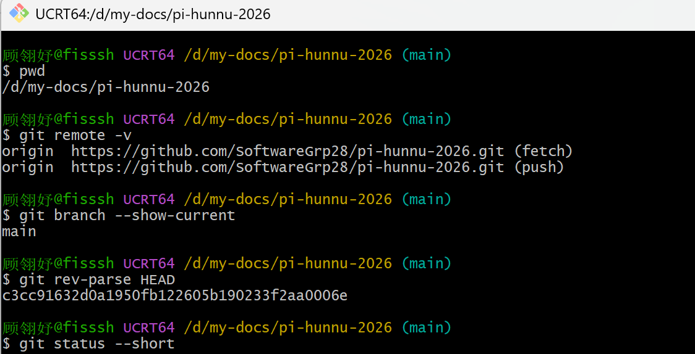
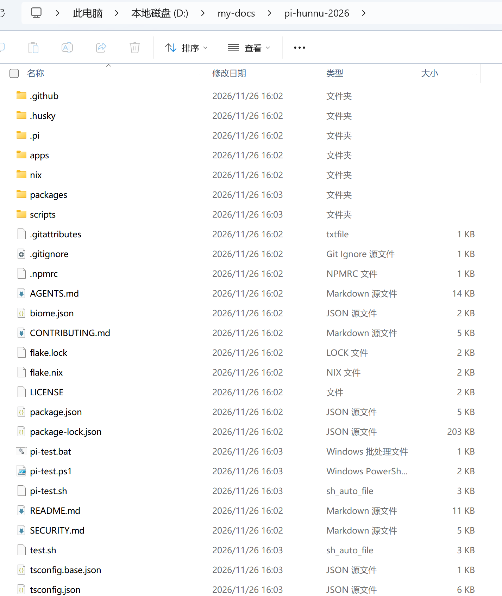
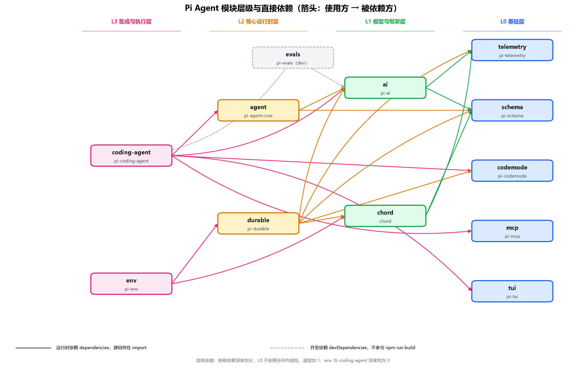
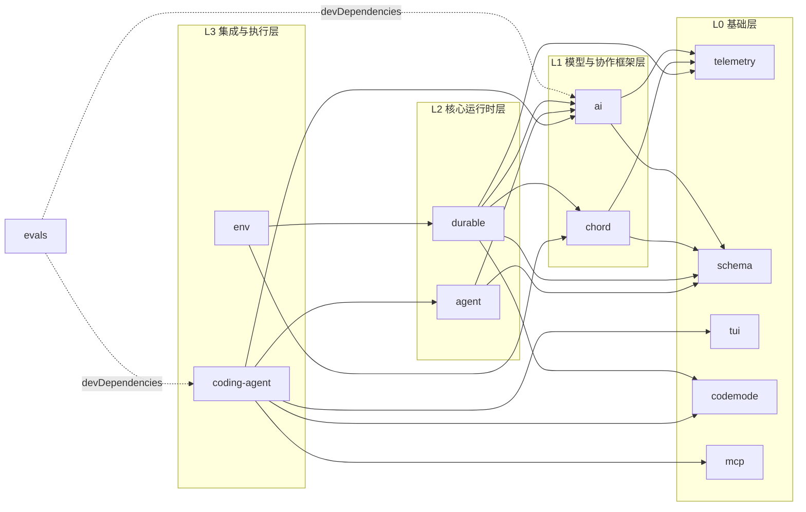

# 实践课2：组织建仓与源码分析

姓名：顾翎妤
| 小组代码仓库 | <https://github.com/SoftwareGrp28/pi-hunnu-2026> |
| 个人作业仓库 | <https://yuuuuoooo.github.io/my‑docs/practice02/> |

> 说明：下文所有路径均相对于仓库根目录 `pi-hunnu-2026/`；命令输出与截图取自本人机器（Windows 11 + Git Bash，仓库位于 `D:\my-docs\pi-hunnu-2026`）。

## 一、源码获取

### 1.1 仓库与版本信息

本人从小组组织 `SoftwareGrp28` 的仓库克隆源码，未使用课程模板中的示例地址：

```bash
git clone --branch main https://github.com/SoftwareGrp28/pi-hunnu-2026.git
cd pi-hunnu-2026
```

克隆后在仓库根目录执行核对命令，结果如下：

| 命令 | 输出 | 结论 |
| --- | --- | --- |
|  `pwd` | `D:\my-docs\pi-hunnu-2026` | 位于全英文路径，非系统盘用户目录 |
| `git remote -v` | `origin  https://github.com/SoftwareGrp28/pi-hunnu-2026.git (fetch/push)` | 指向本组组织仓库，不是上游 `earendil-works/pi` |
| `git branch --show-current` | `main` | 当前分支为 `main` |
| `git rev-parse HEAD` | `c3cc91632d0a1950fb122605b190233f2aa0006e` | 完整提交编号，已记入本报告 |
| `git status --short` | 无输出 | 工作区干净，未修改源码 |

本次分析的基线提交哈希：`c3cc91632d0a1950fb122605b190233f2aa0006e`

### 1.2 截图

**S1：当前目录、远端地址、分支、提交编号**



**源码目录结构（仓库根目录）**



### 1.3 克隆地址（用于 Issue 正文）

```text
https://github.com/SoftwareGrp28/pi-hunnu-2026.git
```

## 二、构建体系分析

### 2.1 模块分析表

| 子文件夹（包名） | 代码主要实现什么功能 | 本模块 `build` 执行什么、生成什么 | 直接依赖的内部模块 | 依据文件 / 代码位置 |
| --- | --- | --- | --- | --- |
| `telemetry`（`@earendil-works/pi-telemetry`） | 与厂商无关的遥测契约：回调式 `TelemetryContext`/`TelemetrySpan`、`NOOP_TELEMETRY_CONTEXT`、计数器/直方图等指标与可序列化的 metric schema；只定义接口，不含 exporter，也不持有全局 current-span | `tsc -p tsconfig.build.json` → `dist/` 下 JS、`.d.ts`、sourcemap | 无 | `packages/telemetry/README.md` 首段；`src/{index,metrics,noop,memory,render}.ts`；`tsconfig.build.json` |
| `schema`（`@earendil-works/pi-schema`） | JSON Schema 构建器与“无 eval”校验器：schema 一次编译为普通闭包，支持 Draft 2020-12 / 7，错误以 JSON Pointer 路径返回，零运行时依赖 | `tsc` → `dist/` | 无 | `packages/schema/README.md`；`src/{builders,compiler,validator,checks}.ts` |
| `chord`（`@earendil-works/chord`） | 跨进程、可热重载的对象/插件框架：object type 契约（用 pi-schema 描述）、facet、reference、document 存储、job、link、principal，支持插件按 host 逐个 reload | `tsc` → `dist/`（含 `node/`、`web/`、`react/`、`tui/`、`sqlite/` 等多入口） | `schema`、`telemetry` | `packages/chord/README.md`；`package.json` dependencies；`src/{contracts,host,store,link,documents}.ts` |
| `tui`（`@earendil-works/pi-tui`） | 终端 UI 框架：差分渲染、CSI 2026 同步输出、主屏/备用屏、滚动与鼠标、Markdown/编辑器/图片等组件、Kitty/iTerm2 内联图片 | `tsc` → `dist/`（原生模块另由 `build:native:*` 构建） | 无 | `packages/tui/README.md`；`src/{tui,tui-alt-screen,components,terminal}.ts` |
| `codemode`（`@earendil-works/pi-codemode`） | 在 QuickJS（编译为 WASM）沙箱中运行模型编写的 JavaScript，唯一能力是调用注入的工具；嵌套工具调用不进入模型上下文；提供 Node worker 与 Cloudflare Durable Object 两套 sandbox | `tsc` → `dist/`（含 `portable`、`cloudflare` 入口） | 无（外部依赖 `quickjs-wasi`） | `packages/codemode/README.md`；`src/{index,portable,cloudflare,wasm}.ts` |
| `mcp`（`@earendil-works/pi-mcp`） | 独立实现的 Model Context Protocol 客户端：transport 无关的 client core、stdio / Streamable HTTP / 内存测试 transport，不依赖官方 MCP SDK | `tsc` → `dist/` | 无（外部依赖 `cross-spawn`） | `packages/mcp/README.md`；`src/{client,transports,protocol}` |
| `ai`（`@earendil-works/pi-ai`） | 统一 LLM 访问层：多 provider 适配、鉴权解析、流式响应与工具调用、token/成本统计、模型目录与会话上下文交接 | `generate-models`（`catalog/generate.ts --strict` 生成 `src/models.generated.ts`、`src/providers/*`）→ `check:model-data` → `tsc` → 复制 `src/providers/data` 到 `dist/providers` | `schema`、`telemetry` | `packages/ai/package.json` scripts；`catalog/generate.ts`；`src/{models,providers,api}` |
| `durable`（`@earendil-works/pi-durable`） | 持久化 agent harness：会话、模型轮次、工具调用先提交到存储再展示，进程中断后可恢复并重试；基于 ai 访问模型、chord 保存 document 状态 | `tsc` → `dist/`；`tsconfig.build.json` 的 `paths` 指向 `../chord/dist/*.d.ts`、`../ai/dist/*.d.ts` | `chord`、`ai`、`codemode`、`schema`、`telemetry` | `packages/durable/README.md`；`package.json` dependencies；`src/{harness,session,storage,tools,codemode}` |
| `env`（`@earendil-works/pi-env`） | 远程执行环境：通过 SSH 在另一台机器上运行工具（文件操作、命令、终端、watch），配一个 Rust daemon（`daemon/`，stdin/stdout 分帧协议） | `tsc` → `dist/`；Rust daemon 由 Cargo 单独构建，不在 `npm run build` 内 | `chord`、`durable` | `packages/env/README.md`；`daemon/Cargo.toml`；`src/{remote-env,ssh,connection,process}.ts` |
| `agent`（`@earendil-works/pi-agent-core`） | 有状态 agent 循环：消息 → 模型 → 工具执行 → 回填，带事件流与可替换的 stream 函数 | `tsc` → `dist/`；`paths` 指向 `../ai/dist/*.d.ts` | `ai`、`schema` | `packages/agent/README.md`；`src/{agent,agent-loop,stream-fn,proxy}.ts` |
| `coding-agent`（`@earendil-works/pi-coding-agent`） | 面向用户的 CLI harness：TUI / RPC 两种模式、扩展与 skills 加载、MCP 与 codemode 工具装配、会话持久化、打包发布 | `build:unbundled`（`tsc` + 可执行位 + 复制资源）→ esbuild 打包为 `dist/bundle/cli.js` | `agent`、`ai`、`codemode`、`mcp`、`tui` | `packages/coding-agent/package.json`；`scripts/build-coding-agent-bundle.mjs`；`src/{cli,modes,extensions,core}` |

> 与作业表格的差异：本人版本中 `packages/` 下共 12 个目录，除上述 11 个外还有 `evals`。`evals` 只声明了 `devDependencies`（`pi-ai`、`pi-coding-agent` 等），不参与根 `npm run build`，因此不进入主依赖图，只在图中以虚线标出。其余 11 个模块与作业表格一致，无增删。

## 三、模块层级与依赖关系

### 3.1 依赖关系图

箭头方向统一为“使用方 → 被依赖方”；实线是 `dependencies` 中声明、源码中确有 import 的运行时依赖，虚线是 `devDependencies`（不参与构建链）。



可编辑图源（Mermaid）：[`assets/dependency-graph.mmd`](assets/dependency-graph.mmd)



### 3.2 层级划分依据

分层标准是**被依赖深度**，而不是目录位置：

- **L0 基础层**：不依赖任何内部包，可独立构建 —— `telemetry`、`schema`、`tui`、`codemode`、`mcp`；
- **L1**：只依赖 L0 —— `ai`（schema、telemetry）、`chord`（schema、telemetry）；
- **L2**：依赖 L1 与 L0 —— `agent`（ai、schema）、`durable`（chord、ai、codemode、schema、telemetry）；
- **L3 集成层**：把下层组合成可交付形态 —— `env`（durable、chord）、`coding-agent`（agent、ai、codemode、mcp、tui）。

层内不再细分：`agent` 与 `durable` 都依赖 `ai`，但二者互不依赖，是两条并列支路；`env` 与 `coding-agent` 同层，也互不依赖。

## 四、三个问题的回答

### 4.1 根目录与子模块的 `npm run build` 分别读取什么配置、执行什么工作？

**根目录**只读取根 `package.json` 的 `scripts.build`。它本身不编译任何代码，做的是“按固定顺序 `cd` 进 11 个包并逐个调用 `npm run build`”，任一包失败即整体失败。共享的 `node_modules` 由 npm workspaces 在安装阶段准备好。

**子模块**读取本包 `package.json` 的 `scripts.build` 和 `tsconfig.build.json`，执行 `tsc` 把 `src/` 编译到 `dist/`，同时产出 `.d.ts` 供下游解析。`ai` 额外做模型目录代码生成与数据复制，`coding-agent` 额外做 esbuild 单文件打包，`env` 的 Rust daemon 与 `tui` 的原生模块都不在这条 npm 构建链里。根目录的 `tsconfig.json`只服务于 `tsc --noEmit` 类型检查，与 `npm run build` 无关。

### 4.2 构建顺序和模块依赖有什么关系？相邻构建的模块是否一定互相依赖？

构建顺序必须满足依赖关系：**被依赖者先构建**。原因是子包之间不是通过 workspace 源码解析，而是通过 `paths` 指向对方的 `dist/*.d.ts`；上游没构建，下游类型解析就失败。所以顺序是依赖图的拓扑排序，只是这份拓扑序是手写在脚本里的。

但**相邻构建的模块不一定互相依赖**。例如：

- 第 3 步 `chord` 与第 4 步 `tui` 相邻，二者没有任何依赖关系，`tui` 甚至不依赖任何内部包；
- 第 5、6 步 `codemode`、`mcp` 相邻，也互不依赖；
- 第 9 步 `env` 在第 10 步 `agent` 之前，但 `agent` 只依赖 `ai`/`schema`，与 `env` 无关；把 `env` 放前面只是因为它属于更下层（依赖 durable），而不是因为 `agent` 需要它。

这说明脚本的排序原则是“按层推进、同层随意”，而不是“相邻即依赖”。反过来说，只要拓扑关系满足，同层模块的顺序可以互换（例如 `chord`、`tui`、`codemode`、`mcp` 之间）。

### 4.3 选择一条至少涉及三个模块的依赖路径，说明分工

选择 **`coding-agent → agent → ai → schema`**（并带出 `telemetry` 作为横切依赖）：

```text
coding-agent ──▶ agent ──▶ ai ──▶ schema
      │            │        └────▶ telemetry
      └────────────┴──────────────▶ ai（直接使用）
```

- **`coding-agent`（产品/交互层）**：负责用户看到的一切 —— CLI 参数、TUI 与 RPC 两种前端、扩展与 skills 的加载、把内置工具（读文件、跑命令、MCP、codemode）装配起来，最后用 esbuild 打成 `dist/bundle/cli.js` 交付。它不实现 agent 循环，也不直接和模型厂商打交道。
- **`agent`（会话循环层）**：实现“消息 → 调模型 → 执行工具 → 把结果写回消息”的循环、事件流和中断/取消，把一次用户请求拆成多轮模型调用。它只认 `ai` 提供的模型接口，不关心前端是 TUI 还是 RPC。
- **`ai`（模型访问层）**：把 Anthropic、OpenAI、Bedrock、Google 等不同厂商的 API 统一成一套流式接口，处理鉴权、重试、token 与成本统计、模型目录。它把“模型返回了什么”翻译成上层可消费的事件。
- **`schema`（契约层）**：为工具参数、配置、消息结构提供 JSON Schema 构建与校验，保证 agent 交给工具的参数、扩展声明的配置在运行时被检查；`ai` 也用它描述工具 schema。
- **`telemetry`（横切层）**：`ai` 与 `coding-agent` 都显式传入 telemetry context，用来记录模型调用耗时、token 数等指标；它不反向依赖任何业务模块。
