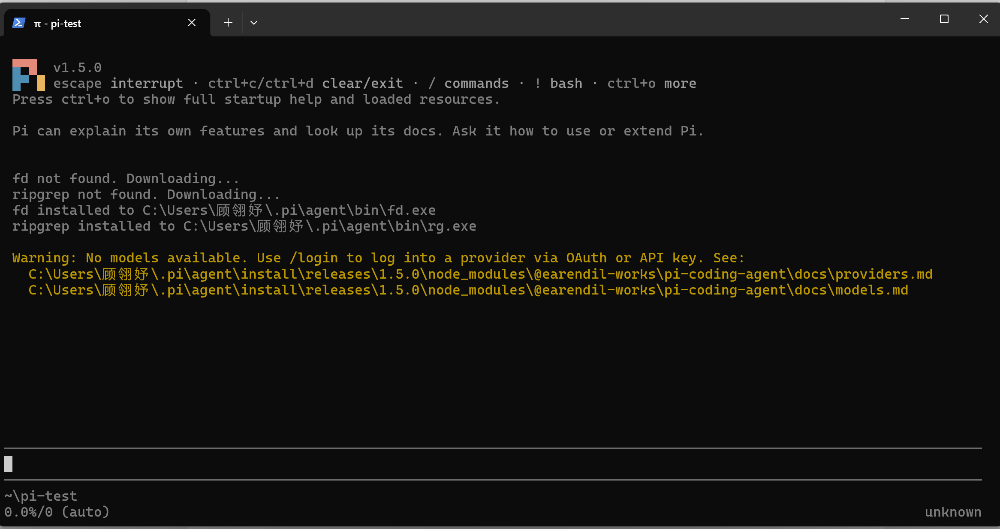
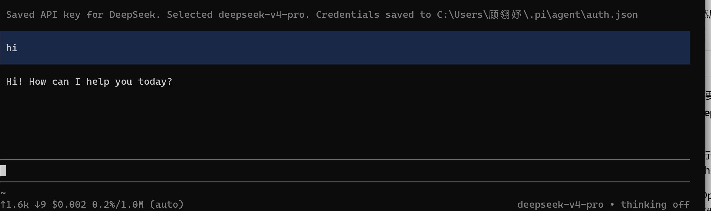
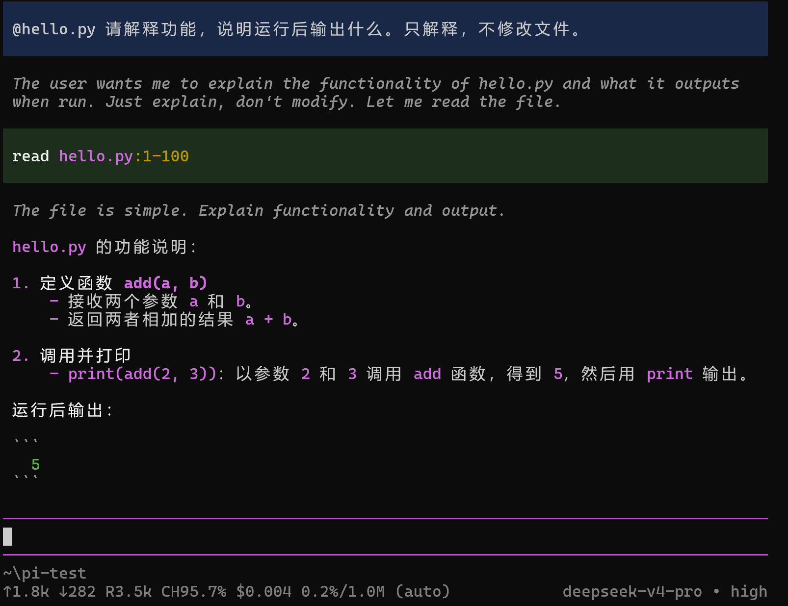

# Pi Agent 安装与基础使用实践报告
姓名：顾翎妤

> 说明：本次只安装Pi客户端，不在本地部署大模型权重。

## 1.实验目的
掌握Pi Agent安装、模型配置、模型切换、文件引用、图片输入、插件与Skill的基础使用。

## 2.实践过程与关键截图
### 任务一：本地安装并启动Pi（S1）
PowerShell执行安装脚本，新建`pi‑test`目录，执行`pi`启动。终端显示版本与工作目录，提示`No models available`，客户端启动成功。

### 任务二：配置模型，完成基础会话（S2）
使用DeepSeek API‑key登录，选用`deepseek‑v4‑pro`。发送`hi`，模型正常回复，对话可用。

### 任务三：切换模型和思考级别（S3）
模型切换：`deepseek‑v4‑pro` → `deepseek‑flash`；
思考级别：`off` → `low`。
测试提问：请用一句话解释持续集成，模型返回正常结果。

> 说明：模型切换前为 deepseek-v4-pro，切换后为 deepseek-flash；思考级别由 off 调整为 low。低复杂度任务可选用 flash 模型、低思考级别，响应更快、开销更小；高复杂度推理任务适合 pro 模型并调高思考级别，结果更严谨，但耗时与 token 消耗会增加。

第一张：切换模型为deepseek‑flash

第二张：调整思考级别为low

### 任务四：@引用代码文件 + 图片测试
#### 4.1 引用代码文件（S4）
pi‑test下创建`hello.py`，使用`@hello.py`引用文件，要求解释代码。AI解析add函数，给出输出5。

#### 4.2 粘贴图片测试（S5，两张截图）
准备蓝色方块带数字7的测试图片，粘贴到输入框，让AI描述图片。

第一张：原始测试图片

第二张：模型识别图片后的回答

### 任务五：安装并试用插件（S6）
选用插件`pi‑web‑access`，执行`pi install npm:pi‑web‑access -l --approve`。重启pi，在Extensions看到插件已加载。
> 选用插件：pi‑web‑access
> 实际选用功能：网页URL抓取，获取网页的页面标题，向Pi发送指令获取https://example.com页面标题，插件成功调用联网工具提取出页面标题Example Domain。
测试：获取https://example.com页面标题，成功拿到标题`Example Domain`。
> Extension用于扩展工具；Skill是任务资源包。

第一张：插件安装完成重启后加载信息

第二张：调用插件获取网页标题的对话结果

### 任务六：PPT Skill安装调用（选做）
下载pptx技能包放到`D:\projects\study\.pi\skills\pptx`，包含SKILL.md、LICENSE.txt、scripts文件夹。重启pi后[Skills]识别pptx。
执行`/skill:pptx 请说明这个 Skill 的名称、用途和所在目录`，返回技能信息与本地路径。

第一张：pptx skill本地目录结构截图

第二张：pi重启后发现并调用pptx skill的会话截图

## 3.问题与解决
1. 启动提示`No models available`：客户端正常，执行`/login`填入API密钥即可。
2. pi install提示找不到npm：重装Node.js，关闭终端重新打开。
3. 图片粘贴无效：确认剪贴板为图片，Windows使用Alt+V粘贴。

## 4.实验小结
Pi Agent是本地终端客户端，依靠API调用远端大模型。`@`可以读取本地文件；插件安装后需要重启生效；Skill放到指定目录会被自动扫描。思考级别影响推理深度、速度与token消耗，根据任务选择。
