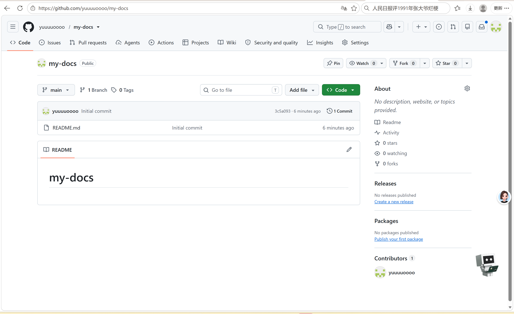
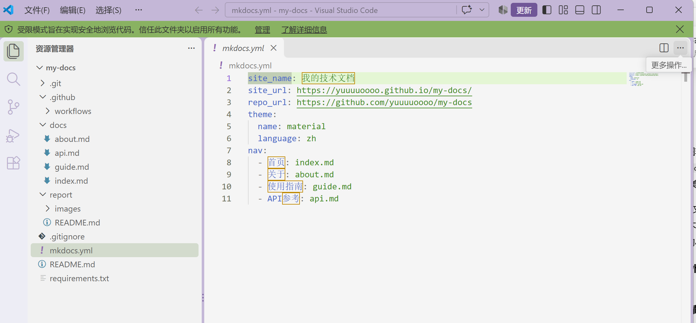
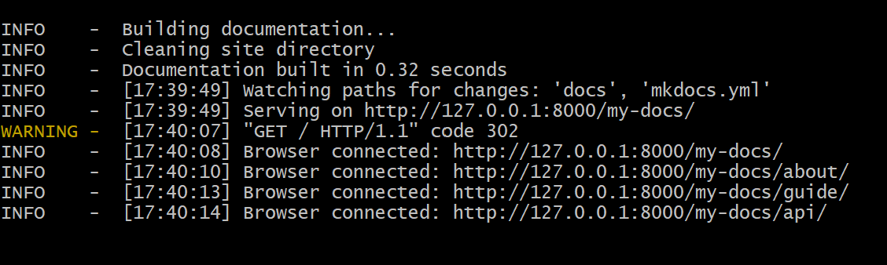
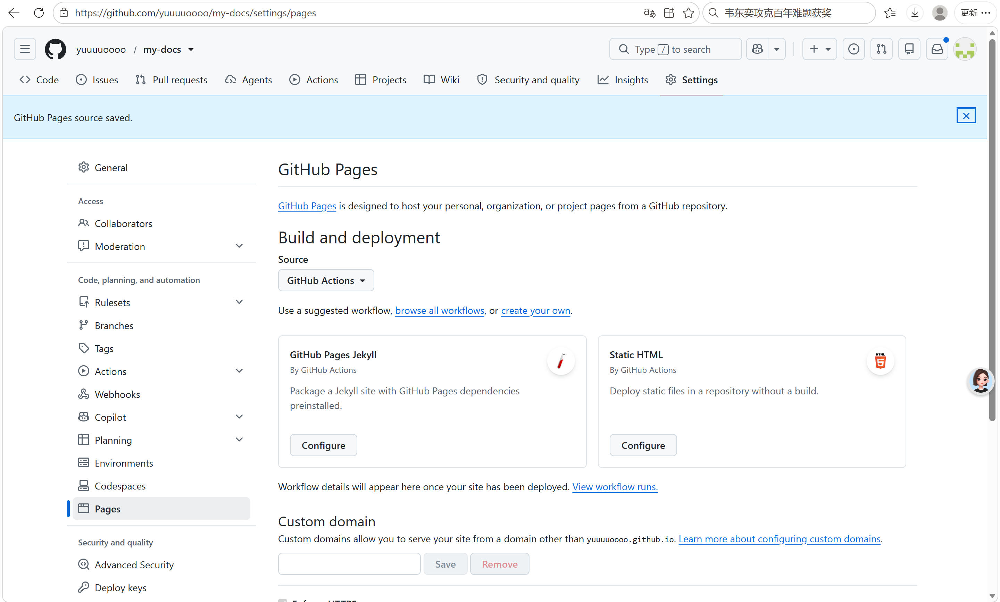
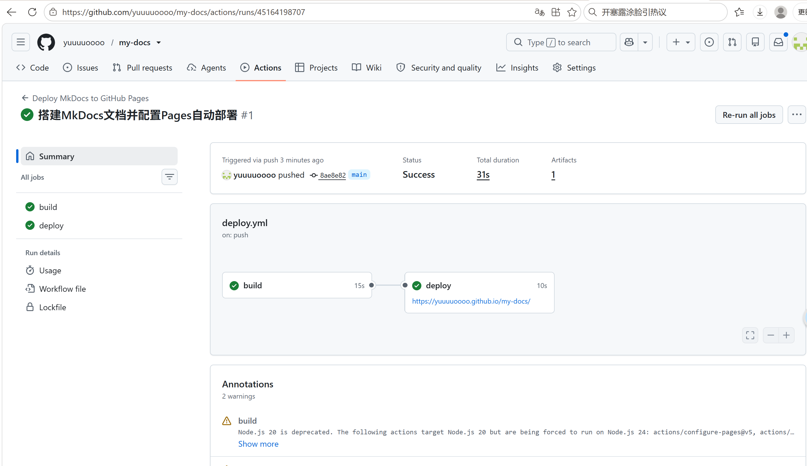
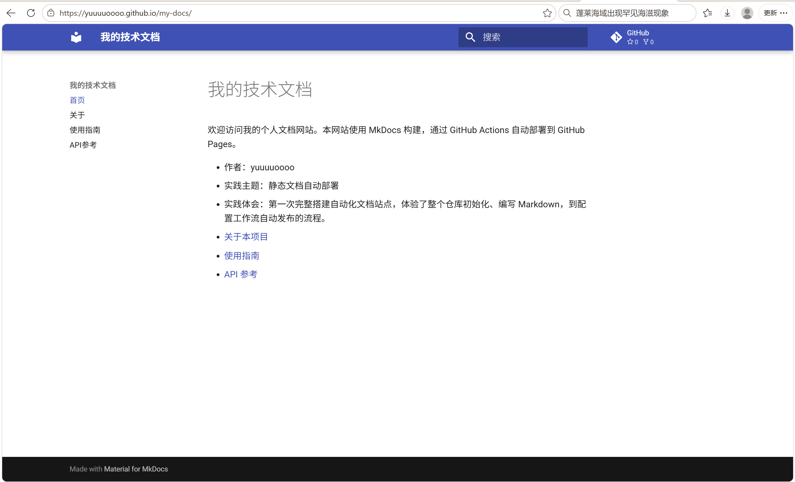
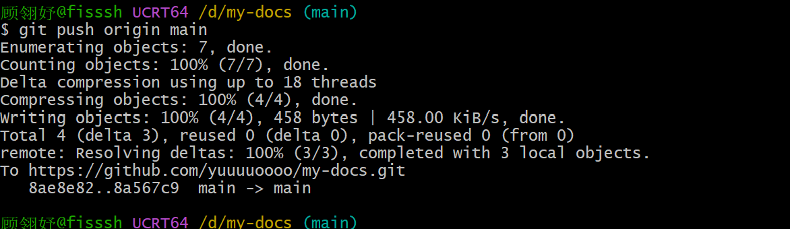
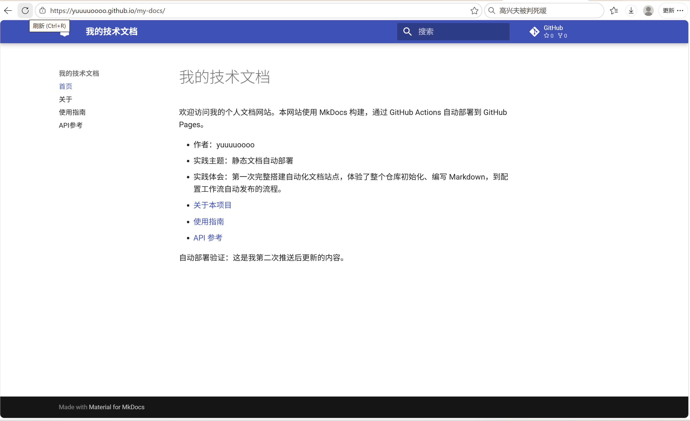

# 实践项目2：个人实验报告

## 1. 基本信息
- GitHub 登录名：yuuuuoooo
- 个人仓库地址：https://github.com/yuuuuoooo/my-docs
- 最终网站地址：https://yuuuuoooo.github.io/my-docs/

## 2. 实践过程与关键截图
### 2.1 仓库创建
说明操作、结果和对应截图。

### 2.2 项目结构与 MkDocs 配置
在本地仓库搭建MkDocs标准目录结构，创建`docs`文件夹存放Markdown文档，在根目录编写`mkdocs.yml`配置文件，配置站点名称、导航栏、Material主题等信息，定义网站导航页面。配置完成后目录结构规范，配置文件无语法报错。

### 2.3 本地构建或预览
在项目目录执行`mkdocs serve`启动本地预览服务，访问`127.0.0.1:8000`，本地预览站点渲染正常，导航、页面内容、主题样式均符合配置预期，验证mkdocs.yml配置和md文档写法无误。

### 2.4 Pages 设置
进入仓库Settings→Pages，部署来源选择GitHub Actions，开启Pages自动部署支持，配置部署权限，允许工作流写入Pages资源，为自动化部署做好前置配置。

### 2.5 Actions 首次构建和部署
推送初始代码至main分支，触发GitHub Actions工作流，流水线依次执行build构建、deploy部署步骤，所有任务绿色成功，首次完成站点自动打包上线。

### 2.6 网站访问与四页导航检查
访问站点地址`https://yuuuoooo.github.io/my-docs/`，打开部署完成的网站，依次点击导航栏四个页面，页面跳转正常、内容加载完整，导航功能验证通过。

### 2.7 第二次推送与自动更新验证
修改文档内容，执行`git push origin main`推送新版本代码，自动触发新一轮Actions流水线，流水线执行成功，刷新线上网站，页面出现新增文字，验证自动更新功能。
- 对应提交链接：`https://github.com/yuuuuoooo/my-docs/commit/8a567c9bf04ee101858d46585bc697e3c9480bb3`
- 对应 Actions 运行链接：`https://github.com/yuuuuoooo/my-docs/actions/runs/45167710432`

## 3. 问题与解决
本次实验过程中未出现报错，全程核对检查：`mkdocs.yml`配置语法、workflow工作流yaml、Git推送日志、Actions流水线日志、Pages分支权限配置、浏览器缓存问题；多次刷新网页确认不是缓存导致的页面不更新，确认每一步流水线日志没有警告，部署流程稳定。

## 4. 原理理解
1. **docs/ 和 site/ 各保存什么？为什么不用手工修改 site/？**
`docs/`存放原始Markdown源文档，是我们编写、维护的源码；`site/`是`mkdocs build`命令编译生成的静态网页（html、css、js）。site是编译产物，会在每次build时被覆盖重生成，手动修改site内的文件，下次构建改动会直接丢失，所以不手动修改site目录。

2. **本次工作流在什么情况下自动运行？**
工作流配置监听`main`分支的push事件：当代码推送到main分支时，自动触发Actions流水线运行。

3. **build 与 deploy 两个任务有什么区别？**
- build：使用mkdocs把docs下的md源码编译为静态网站文件，生成站点资源；
- deploy：把build产出的静态文件上传发布到GitHub Pages服务，对外提供网页访问。
build负责编译，deploy负责发布上线。

4. **只修改 report/README.md 会触发部署吗？为什么？**
会触发。本次workflow触发条件是push到main分支，只要往main分支推送提交，不管修改哪个文件，都会触发流水线（除非workflow里配置了paths过滤规则）。

5. **本次方案为何无需创建 gh-pages 分支？**
新版GitHub Pages支持直接由Actions部署，将静态资源直接发布到Pages服务，不需要单独维护gh-pages分支；部署时由工作流自动处理Pages的部署资源，不需要手动新建、切换gh-pages分支。
